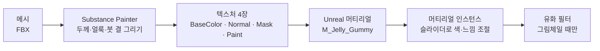

# 🍬 젤리 머티리얼 가이드

Unreal Engine 5.8 의 **머티리얼 그래프**(유니티 Shader Graph 같은 노드 방식)와 **Substance 3D Painter** 로 만든 스타일라이즈드 젤리 머티리얼 안내서입니다.
언리얼을 처음 다루는 사람도 따라올 수 있게, **결과 → 사용법 → 원리** 순서로 정리했습니다.

## 👋 처음이라면 여기부터

| 순서 | 페이지 | 읽는 시간 | 이런 분께 |
|:---:|---|:---:|---|
| 1 | [🎨 젤리 갤러리](01-젤리-갤러리) | 1분 | 어떤 젤리를 만들 수 있는지 먼저 보고 싶다 |
| 2 | [🚀 바로 써보기](02-바로-써보기) | 10분 | 원리는 몰라도 내 메시에 젤리를 입히고 싶다 |
| 3 | [🎚 슬라이더 사전](03-슬라이더-사전) | 필요할 때 | 원하는 느낌을 내려면 무엇을 돌려야 하는지 |
| 4 | [🧪 어떻게 만들어졌나](04-어떻게-만들어졌나) | 15분 | 노드 그래프가 어떻게 젤리가 되는지 궁금하다 |
| 5 | [🖌 Painter 텍스처 만들기](05-Painter-텍스처-만들기) | 1시간 | 내 메시용 텍스처를 직접 만들고 싶다 |
| 6 | [🩹 문제 해결](06-문제-해결) | 필요할 때 | 화면이 이상하게 나온다 |
| 7 | [📓 노드 셰이더 기록](07-노드-셰이더-기록) | 10분 | 유니티 Shader Graph 와 비교한 작업 기록 |
| 8 | [🗓 변경 이력](08-변경-이력) | 5분 | 처음부터 지금까지 무엇이 바뀌었나 |

## ⚡ 한눈에 보는 흐름

## 📌 꼭 알아둘 3가지

1. **색은 언리얼에서 정합니다.** Painter 텍스처는 거의 흰색이고, 빨강·파랑은 인스턴스의 `Jelly Color` 로 바꿉니다.
2. **젤리 느낌의 핵심은 두께**입니다. 얇은 곳은 밝고 투명, 두꺼운 곳은 진하고 탁하게.
3. **노드를 직접 만들 필요는 없습니다.** 이미 만든 머티리얼의 **인스턴스를 복사**해서 슬라이더만 돌리면 됩니다.

## 🛠 환경

| 항목 | 버전 |
|---|---|
| 엔진 | Unreal Engine 5.8.4 |
| 텍스처 | Adobe Substance 3D Painter 12.2 |
| 보조 도구 | Python (메시·두께·붓 자국·별 텍스처 생성, 에디터 자동화) |
| 룩데브 레벨 | `Content/JellyGame/Maps/L_JellyLookDev` |
