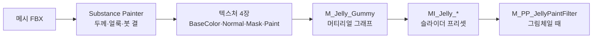

  

  
  
  
  
  

# 🍬 UE5 Stylized Jelly Lab

Unreal Engine 5 기반 **스타일라이즈드 젤리 아트 연구**.
젤리 머티리얼과 셰이딩, 말랑한 변형 표현, Substance Painter 연동 파이프라인을 실험합니다.

---

## 🎨 Gallery — 발전한 순서

| ① 단색 | ② 두께 | ③ 투과 | ④ 다색 빛 |
|:---:|:---:|:---:|:---:|
|  |  |  |  |
| **⑤ 그림체** | **⑥ 붓질 + 유화** | **⑦ 통합** | **⑧ 속 글리터 (최신)** |
|  |  |  |  |

모두 같은 마스터 머티리얼에서 **슬라이더 값만 바꾼** 결과입니다 → [갤러리 자세히](https://github.com/JiwonEnv/UE5-Stylized-Jelly-Lab/wiki/01-젤리-갤러리)

---

## 🧪 Material Features

| 효과 | 설명 |
|---|---|
| 💧 두께 흡수색 | 얇은 곳은 밝고 투명, 두꺼운 곳은 진하고 탁하게 (Painter 두께 맵) |
| 🪟 투과 | **Thin Translucent** — 뒤 배경이 젤리 색으로 물들어 비침 |
| ✨ 스튜디오 하이라이트 | 반사 방향으로 그린 크고 또렷한 흰 반사 + 속에서 빛나는 느낌 |
| 🌈 다색 빛 | 몸통 안쪽 3색 그라데이션 · 좌우 2색 림 라이트 · 무지개빛(박막) |
| 🖌 그림체 | 계단 음영 · 셀 3톤 · 붓 자국 단위 색 면 · 흰 대시 하이라이트 · 외곽 톤 |
| 🎞 유화 필터 | Kuwahara 포스트 프로세스 (HLSL Custom 노드), 커스텀 스텐실로 젤리에만 |
| ⭐ 반짝이 | 4각·6각 별 스프라이트 · 유리 테두리 선 · 젤리 속 글리터(머티리얼 함수) |
| 🎮 게임용 경량판 | 노드 20개 · 파라미터 9개 `M_Jelly_Gummy_Gameplay` |

---

## ⚡ Pipeline

| 단계 | 하는 일 | 도구 |
|---|---|---|
| 🖌 Texture | 두께·색 얼룩·기포·붓 결을 채널별로 그림 | Substance 3D Painter |
| 🧪 Shade | 노드 그래프로 젤리 계산 (Shader Graph 와 같은 방식) | Unreal Material Editor |
| 🎚 Tune | 인스턴스 슬라이더로 색·느낌 조절 | Material Instance |
| 🤖 Automate | 메시·두께·붓 자국·별 텍스처 생성, 에디터 빌드·촬영 | Python (UE Remote Execution, Painter Remote Scripting) |

---

## 📖 Docs

| | 페이지 | 내용 |
|:---:|---|---|
| 🏠 | [Wiki Home](https://github.com/JiwonEnv/UE5-Stylized-Jelly-Lab/wiki) | 처음이라면 여기부터 |
| 🚀 | [바로 써보기](https://github.com/JiwonEnv/UE5-Stylized-Jelly-Lab/wiki/02-바로-써보기) | 내 메시에 젤리 입히기 (원리 몰라도 OK) |
| 🎚 | [슬라이더 사전](https://github.com/JiwonEnv/UE5-Stylized-Jelly-Lab/wiki/03-슬라이더-사전) | 슬라이더별 비교 이미지와 추천값 |
| 🧪 | [어떻게 만들어졌나](https://github.com/JiwonEnv/UE5-Stylized-Jelly-Lab/wiki/04-어떻게-만들어졌나) | 젤리 4층 원리 · 노드 5가지 |
| 🖌 | [Painter 텍스처 만들기](https://github.com/JiwonEnv/UE5-Stylized-Jelly-Lab/wiki/05-Painter-텍스처-만들기) | 레이어 12개 · 내보내기 |
| 🩹 | [문제 해결](https://github.com/JiwonEnv/UE5-Stylized-Jelly-Lab/wiki/06-문제-해결) | 증상별 원인과 해결 |
| 📓 | [노드 셰이더 기록](https://github.com/JiwonEnv/UE5-Stylized-Jelly-Lab/wiki/07-노드-셰이더-기록) | 유니티 Shader Graph 대응표 · 시행착오 |
| 🗓 | [변경 이력](https://github.com/JiwonEnv/UE5-Stylized-Jelly-Lab/wiki/08-변경-이력) | v0 → v11 |

수식·노드·HLSL 전체: [JellyMaterialGuide.ko.md](Docs/JellyMaterial/JellyMaterialGuide.ko.md)

---

## 🛠 Tech Stack

| 분야 | 사용 |
|---|---|
| 🎮 Engine | Unreal Engine 5.8.4 |
| 🧪 Shading | Material Editor · Material Function · Material Instance · Post Process Material · Custom HLSL · Custom Depth-Stencil |
| 🖌 Texture | Substance 3D Painter 12.2 (Fill/Mask/Generator 레이어, User 채널 패킹) |
| 🤖 Automation | Python — UE Python Remote Execution, Painter Remote Scripting, numpy 절차 텍스처 |
| 🌐 Workflow | Git · Git LFS · GitHub Wiki |
